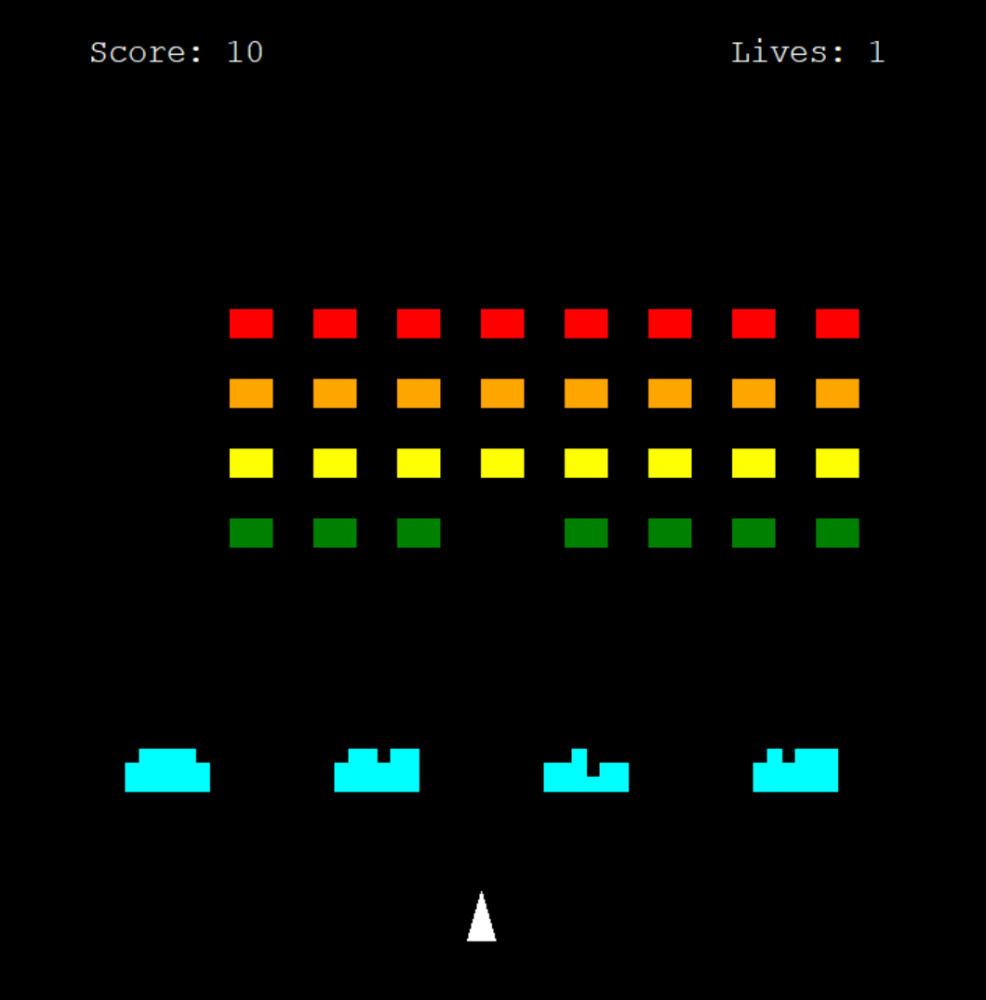

# Space Invaders (Python Turtle)

A classic Space Invaders clone built with Python's built-in `turtle` module. Move your ship, shoot the alien fleet, hide behind destructible barriers, and survive their return fire.



## Features

- Player ship with left/right movement and one-shot-at-a-time firing
- 4×8 alien fleet that marches sideways and drops down at each wall
- Aliens speed up as their numbers shrink
- Aliens fire back (only the bottom alien in each column shoots)
- Four destructible barriers made of individual bricks, damaged by both sides
- Score (10 points per alien) and 3 lives
- Win by clearing the fleet; lose when you run out of lives or the aliens reach your ship

## Controls

| Key | Action |
|-----|--------|
| Left Arrow | Move left |
| Right Arrow | Move right |
| Space | Fire |

## Run it

No third-party packages needed. `turtle` ships with Python (3.8+).

```bash
python main.py
```

## Project structure

| File | Responsibility |
|------|----------------|
| `main.py` | Screen setup, key bindings, game loop |
| `player.py` | Player ship and movement |
| `bullet.py` | Player bullet |
| `aliens.py` | Alien fleet: creation, movement, hit and game-over checks |
| `alien_bullets.py` | Alien return fire |
| `barriers.py` | Destructible barrier bricks |
| `scoreboard.py` | Score, lives, and end-of-game messages |

## How it works

- **Game loop:** `screen.tracer(0)` turns off auto-redraw, and `screen.update()` redraws once per frame (about 50 FPS).
- **Alien movement:** the fleet moves on its own timer (`move_delay`) rather than every frame, so the loop stays smooth while the aliens march at a steady pace.
- **Collisions:** distance checks between turtles (`turtle.distance()`).
- **Difficulty:** each alien destroyed shortens `move_delay`, so the fleet speeds up.

## Ideas for future improvements

- Aliens erase barrier bricks on contact
- Restart key after game over
- Sound effects
- Multiple levels with faster fleets
- Bonus UFO that crosses the top of the screen

## Built with

- Python 3
- `turtle` (standard library)
